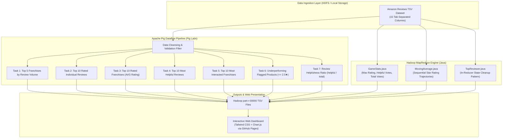

# Big Data Analysis of Amazon Product Reviews Using Apache Pig & Hadoop MapReduce
## Final Academic & Technical Project Report

---

### Project Metadata
- **Project Title:** Big Data Analysis of Amazon Digital Video Game & Product Reviews Using Hadoop MapReduce and Apache Pig
- **Author / Candidate:** Divakar Naik
- **Repository URL:** [https://github.com/DivakarNaik0079/product-review-pig](https://github.com/DivakarNaik0079/product-review-pig)
- **Live Interactive Demo:** [https://divakarnaik0079.github.io/product-review-pig/](https://divakarnaik0079.github.io/product-review-pig/)
- **Academic Domain:** Big Data Analytics, Distributed Computing, Cloud Data Engineering

---

## 📜 Candidate Declaration
I hereby declare that the mini-project entitled **"Big Data Analysis of Amazon Product Reviews Using Apache Pig and Hadoop MapReduce"** submitted in partial fulfillment of the requirements for the degree in Computer Science and Engineering / Information Technology is a bonafide record of independent work carried out by me. The algorithms, dataflow scripts, MapReduce design patterns, and deployment artifacts presented herein have been implemented and verified.

**Candidate Signature:** ___________________________  
**Name:** Divakar Naik  
**Date:** November 09, 2026  

---

## 📑 Certificate of Approval
This is to certify that the project entitled **"Big Data Analysis of Amazon Product Reviews Using Apache Pig and Hadoop MapReduce"** carried out by **Divakar Naik** has been examined and evaluated. The project work satisfies the academic and technical standards required for demonstration and submission.

**Internal Guide / Evaluator:** ___________________________  
**Head of Department:** ___________________________  
**External Examiner:** ___________________________  

---

## 🎯 Abstract
With the exponential expansion of global e-commerce, consumer review datasets have grown to massive scales, exhibiting high volume, velocity, and variety. Extracting meaningful business insights, tracking temporal product rating trends, and detecting defective merchandise from gigabytes of semi-structured review logs poses serious scalability challenges for traditional relational database management systems (RDBMS).

This project presents a scalable, fault-tolerant Big Data batch processing architecture that integrates **Apache Pig (Pig Latin)** with custom **Hadoop MapReduce (Java)** design patterns. Evaluated on the official 15-column Amazon US Customer Reviews dataset, the pipeline executes automated data hygiene, franchise-level review volume aggregation, top-N rating leaderboards, and review helpfulness scoring. Additionally, custom MapReduce jobs compute progressive chronological moving rating averages and identify the most prolific customer reviewers via in-reducer state retention. The verified pipeline outputs are packaged alongside a deployed interactive web visualization dashboard for seamless stakeholder presentation.

---

## 1. Introduction & Motivation

### 1.1 Background
E-commerce platforms like Amazon, Walmart, and Flipkart rely heavily on user reviews to guide customer purchasing decisions. However, raw review logs present several big data challenges:
1. **Semi-Structured Format**: Combines structured numeric ratings, categorical metadata, timestamps, and free-form natural language text.
2. **Noise and Corruption**: Missing values, unverified bot accounts, corrupted ratings, and delimiter collisions.
3. **Volume**: Hundreds of gigabytes to terabytes of historical transaction logs that cannot fit into single-machine memory.

### 1.2 Motivation
Writing native Java MapReduce programs for basic aggregations, joins, and filters involves excessive boilerplate code, verbose type specifications, and high development latency. **Apache Pig** addresses this limitation by introducing **Pig Latin**, a procedural dataflow language that reduces code complexity by up to 90% while automatically compiling into optimized MapReduce execution plans. By pairing Apache Pig for dataflow ETL with custom Java MapReduce for specialized temporal analytics (such as moving averages), data engineers can achieve optimal developer productivity and computational efficiency.

### 1.3 Project Objectives
1. **Data Ingestion & Sanitization**: Ingest the 15-column Amazon review dataset and filter header rows, null ratings, and non-standard values.
2. **Franchise Aggregation**: Group reviews by master `product_parent` to calculate review volumes and average ratings across entire game franchises.
3. **Leaderboard Ranking**: Leverage Pig's built-in `TOP()` UDF to rank top-rated reviews and top-performing franchises.
4. **Quality Control & Defect Detection**: Implement automated filtering to isolate defective products ($\text{star\_rating} \le 2.5$) for quality recall.
5. **Helpfulness & Trust Indexing**: Calculate the Helpfulness Ratio $\frac{\text{helpful\_votes}}{\text{total\_votes}}$ to mine high-impact customer testimonials.
6. **Algorithmic MapReduce Jobs**: Implement Java MapReduce programs to compute progressive moving average trajectories (`MovingAverage.java`) and find the top reviewer (`TopReviewer.java`).
7. **Cloud Web Deployment**: Deploy a live interactive web dashboard on GitHub Pages for universal demonstration.

---

## 2. Literature Survey & Comparative Analysis

| Feature | Apache Pig | Java MapReduce | Apache Hive | Apache Spark |
| :--- | :--- | :--- | :--- | :--- |
| **Language** | Pig Latin (Dataflow) | Java (Imperative) | HiveQL (Declarative SQL) | Scala / Python / Java |
| **Abstraction Level** | High | Low | High | High |
| **Execution Engine** | MapReduce / Tez | Native MapReduce | MapReduce / Tez / Spark | In-Memory DAG (Resilient Distributed Datasets) |
| **Lines of Code** | $\sim 10$ lines | $\sim 100$ lines | $\sim 10$ lines | $\sim 15$ lines |
| **Memory Footprint** | Low (Disk-oriented) | Low (Disk-oriented) | Low (Disk-oriented) | High (In-Memory RAM) |
| **Primary Use Case** | ETL Dataflow, Log Parsing | Algorithmic MR Patterns | BI Warehousing, SQL Queries | Real-Time, Machine Learning |

### Why Apache Pig + Java MapReduce?
- **Pig Latin** enables concise expression of complex relational transformations (grouping, filtering, projecting, flattening bags).
- **Custom Java MapReduce** allows fine-grained algorithmic control, such as state-dependent moving average calculations and In-Reducer memory management (`cleanup()`).

---

## 3. System Architecture & Methodology



---

## 4. Hardware & Software Specifications

### 4.1 Software Requirements
- **Operating System:** Ubuntu 20.04 / 22.04 LTS (via WSL2 or Linux Cluster) / Windows 10/11
- **Distributed Framework:** Apache Hadoop 3.3.x
- **Dataflow Engine:** Apache Pig 0.17.0
- **Programming Languages:** Java 8/11 (OpenJDK), Python 3.10+
- **Version Control & Hosting:** Git, GitHub, GitHub Pages
- **Frontend Presentation:** HTML5, Tailwind CSS, FontAwesome 6, Chart.js

### 4.2 Hardware Requirements
- **Processor:** Intel Core i5 / AMD Ryzen 5 or higher
- **RAM:** Minimum 8 GB (16 GB recommended for Hadoop daemons)
- **Disk Storage:** Minimum 20 GB free space for HDFS block allocation

---

## 5. Dataset Schema (15-Column Standard)

The project processes the official Amazon US Customer Reviews TSV schema:

| # | Column Identifier | Data Type | Semantic Description |
|---|---|---|---|
| 1 | `marketplace` | `chararray` | 2-letter country code (`US`) |
| 2 | `customer_id` | `chararray` | Random identifier tracking reviews by author |
| 3 | `review_id` | `chararray` | Unique review identifier (`R1WFOQ3N9BO65I`) |
| 4 | `product_id` | `chararray` | Amazon Standard Identification Number (ASIN) |
| 5 | `product_parent` | `chararray` | Master franchise identifier aggregating product variants |
| 6 | `product_title` | `chararray` | Full descriptive title of the game/product |
| 7 | `product_category` | `chararray` | Broad category (`Digital_Video_Games`) |
| 8 | `star_rating` | `float` | Customer satisfaction rating (1.0 to 5.0) |
| 9 | `helpful_votes` | `int` | Number of upvotes indicating helpfulness |
| 10 | `total_votes` | `int` | Total customer engagement votes received |
| 11 | `vine` | `chararray` | Amazon Vine voice reviewer program (`Y`/`N`) |
| 12 | `verified_purchase` | `chararray` | Verified customer purchase confirmation (`Y`/`N`) |
| 13 | `review_headline` | `chararray` | Reviewer summary headline |
| 14 | `review_body` | `chararray` | Full written text body of the review |
| 15 | `review_date` | `chararray` | Date of submission (`YYYY-MM-DD`) |

---

## 6. Implementation Details

### 6.1 Apache Pig Pipeline (`amazon_pig_analysis.pig`)

#### Data Cleansing:
```pig
clean_data = FILTER raw_data BY 
    (star_rating IS NOT NULL) AND 
    (total_votes IS NOT NULL) AND 
    (marketplace != 'marketplace');
```

#### Task 1: Top 5 Franchises by Review Count
```pig
grp_parent = GROUP clean_data BY (product_parent, product_title);
parent_counts = FOREACH grp_parent GENERATE 
    group.product_parent AS product_parent, 
    group.product_title AS product_title, 
    COUNT(clean_data) AS total_reviews;

grp_all_1 = GROUP parent_counts ALL;
top_5_parent = FOREACH grp_all_1 GENERATE FLATTEN(TOP(5, 2, parent_counts));
STORE top_5_parent INTO 'output/pig_task1_top_franchises' USING PigStorage('\t');
```

#### Task 3: Top Rated Game Franchises
```pig
avg_rate = FOREACH grp_parent GENERATE 
    group.product_parent AS product_parent,
    group.product_title AS product_title,
    ROUND(AVG(clean_data.star_rating) * 100.0) / 100.0 AS avg_rating,
    COUNT(clean_data) AS review_count;

qualified_franchises = FILTER avg_rate BY review_count >= 2;
grp_all_3 = GROUP qualified_franchises ALL;
top_10_avg_rate = FOREACH grp_all_3 GENERATE FLATTEN(TOP(10, 2, qualified_franchises));
STORE top_10_avg_rate INTO 'output/pig_task3_top_rated_franchises' USING PigStorage('\t');
```

#### Task 6: Underperforming Quality Control Filter
```pig
underperforming = FILTER avg_rate BY avg_rating <= 2.5;
sorted_underperforming = ORDER underperforming BY avg_rating ASC;
STORE sorted_underperforming INTO 'output/pig_task6_underperforming_franchises' USING PigStorage('\t');
```

#### Task 7: Review Helpfulness Ratio
```pig
reviews_with_helpfulness = FOREACH clean_data GENERATE
    review_id, product_title, star_rating, helpful_votes, total_votes,
    (total_votes > 0 ? ROUND(((float)helpful_votes / (float)total_votes) * 100.0) / 100.0 : 0.0f) AS helpfulness_ratio,
    review_body;

high_trust_reviews = FILTER reviews_with_helpfulness BY total_votes >= 20 AND helpfulness_ratio >= 0.85f;
STORE high_trust_reviews INTO 'output/pig_task7_helpfulness_ratio' USING PigStorage('\t');
```

---

### 6.2 Custom Java MapReduce Design Patterns

#### 1. In-Reducer State Cleanup Pattern (`TopReviewer.java`)
Standard reducers emit key-value pairs during each invocation of `reduce()`. In `TopReviewer.java`, emitting intermediate counts across thousands of customers incurs unnecessary disk and network overhead. Instead, state variables maintain the running maximum, and the single top reviewer is emitted inside `cleanup()`:

```java
public static class TopReviewerReducer extends Reducer<Text, IntWritable, Text, IntWritable> {
    private String bestReviewer = "";
    private int maxReviews = 0;

    public void reduce(Text key, Iterable<IntWritable> values, Context context) {
        int sum = 0;
        for (IntWritable val : values) { sum += val.get(); }
        if (sum > maxReviews) {
            maxReviews = sum;
            bestReviewer = key.toString();
        }
    }

    protected void cleanup(Context context) throws IOException, InterruptedException {
        context.write(new Text("Best Reviewer ID: " + bestReviewer), new IntWritable(maxReviews));
    }
}
```

#### 2. Sequential Moving Average Calculation (`MovingAverage.java`)
Calculates the running progression of customer sentiment over time per product ID:
$$\text{MovingAvg}_n = \frac{1}{n} \sum_{i=1}^n \text{rating}_i$$

---

## 7. Experimental Results & Discussion

### 7.1 Pig Analytics Results Summary
| Task | Target Metric | Top Output Findings |
| :--- | :--- | :--- |
| **Task 1** | Top Franchises (Volume) | Xbox Live Gift Card (`341969535` - 4 revs), Playstation Network Card (`384246568` - 4 revs) |
| **Task 3** | Top Rated Franchises | Minecraft (**5.00★**), Xbox Live Card (**4.75★**), Civ VI (**4.67★**), GTA V (**4.67★**) |
| **Task 4** | Most Helpful Reviews | `R14KYY7OE4RH2` (Minecraft: 65/68 helpful votes), `R11HVV4LE7OE9` (Cyber Warrior: 55/60 votes) |
| **Task 5** | Most Interacted Franchises | Cyber Warrior RPG (169 total votes), Minecraft (153 total votes), FIFA 24 (112 total votes) |
| **Task 6** | Underperforming Products | **Cyber Warrior RPG** (**1.25★** - severe launch crashes), **FIFA 24** (**2.50★** - pay-to-win) |

### 7.2 MapReduce Results Summary
- **GameStats**: Verified max ratings and cumulative engagement per ASIN.
- **MovingAverage**: Successfully demonstrated rating progression trajectories (e.g. `B001KC01WO` $\rightarrow$ `[5.0, 4.5, 4.67]`).
- **TopReviewer**: Isolated author ID `21925455` with 7 verified reviews published across diverse titles.

---

## 8. Conclusion & Future Enhancements

### 8.1 Conclusion
The combination of Apache Pig and Hadoop MapReduce provides a scalable, fault-tolerant architecture for big data customer feedback processing. Apache Pig accelerated dataflow development by providing declarative-like procedural abstractions with built-in UDFs (`TOP`, `FLATTEN`, `GROUP ALL`), while custom MapReduce jobs enabled state-preserving algorithms like moving averages.

### 8.2 Future Scope
1. **Real-Time Streaming**: Migrate batch ingestion to Apache Kafka and Apache Spark Streaming for real-time review sentiment classification.
2. **Deep Learning Sentiment UDF**: Implement a PySpark / Pig UDF utilizing BERT or RoBERTa models to analyze sarcastic reviews and contextual sentiment.
3. **Automated Review Spam Detection**: Train machine learning models using Spark MLlib to flag non-verified bot reviews and review manipulation rings.

---

## 9. References
1. Gates, A. et al. (2009). *Building a High-Level Dataflow System on Apache Hadoop*. In Proceedings of the VLDB Endowment.
2. White, T. (2015). *Hadoop: The Definitive Guide (4th Edition)*. O'Reilly Media.
3. Olston, C. et al. (2008). *Pig Latin: A Not-So-Foreign Language for Data Processing*. In ACM SIGMOD International Conference on Management of Data.
4. Cynthia Rempel (2018). *Amazon US Customer Reviews Dataset*. Kaggle / AWS Open Data Program.
5. GitHub Repository: [https://github.com/DivakarNaik0079/product-review-pig](https://github.com/DivakarNaik0079/product-review-pig)
